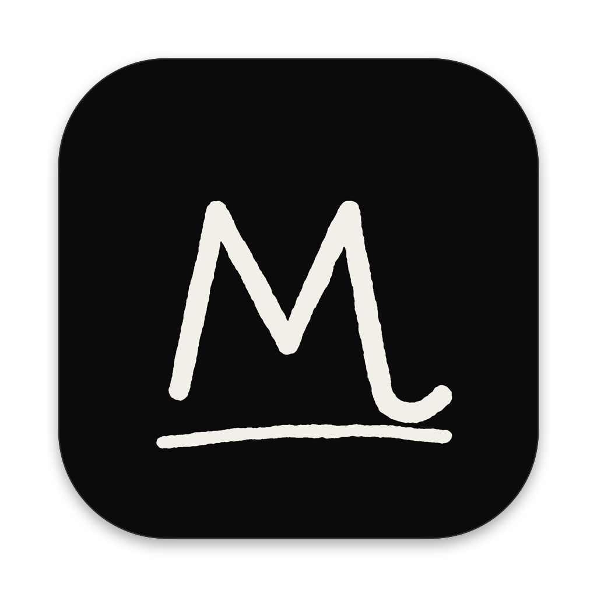
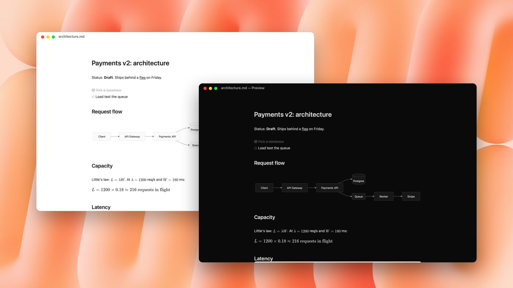
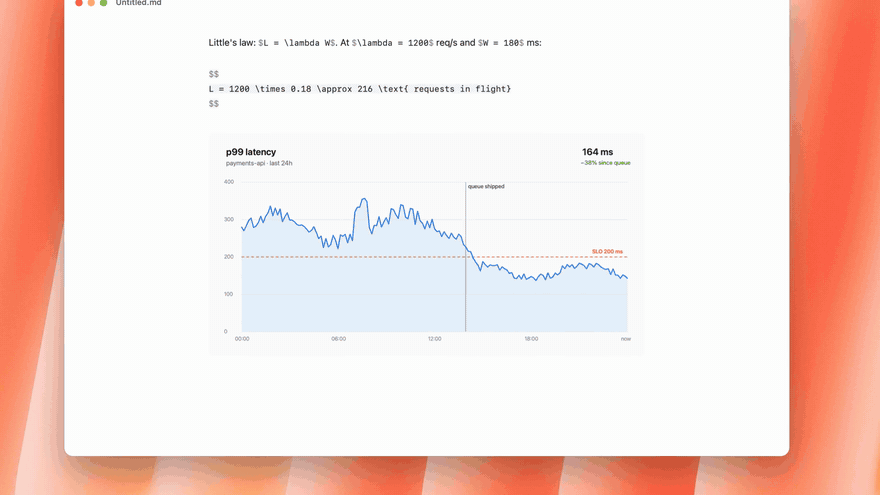

<p align="center">
  
</p>

<h1 align="center">Mark</h1>

<p align="center">
  <b>A tiny, native Markdown editor for macOS.</b><br>
  Right-click your Desktop → <i>New Markdown File</i> → start typing.
</p>

<p align="center">
  <code>brew install --cask vinny380/tap/mark</code>
</p>

<p align="center">
  920 KB · native AppKit · no Electron · no account · your files stay plain <code>.md</code>
</p>

<p align="center">
  <a href="docs/media/mark-launch.mp4"></a>
  <br><sub>▶ <a href="docs/media/mark-launch.mp4">Watch the 30-second demo</a></sub>
</p>

---

Making a Markdown file shouldn't mean opening a terminal or an IDE. Mark lives in Finder's right-click menu: one click gives you `Untitled.md` wherever you are, open and ready. You type Markdown, and it styles as you go: headings grow, `**bold**` gets bold, and the symbols fade to gray instead of disappearing. Press ⌘E and they're gone.

<p align="center">
  
</p>

## What it does

- **New file from anywhere.** Right-click the Desktop or any Finder folder → *New Markdown File*. Or `mark notes` in Terminal.
- **Styles as you type.** One pane, no split preview. Markdown symbols stay visible but quiet.
- **⌘E Preview.** Symbols disappear, links become clickable, to-dos become ☐ ☑, and these render:
  - **Mermaid diagrams** in ` ```mermaid ` blocks
  - **Math**: `$inline$`, `$$blocks$$`, and ` ```math `
  - **Images**: from the web, or files next to your note
- **Drop images in.** Drag a file, a browser image, or paste a screenshot. Files are copied to `./assets` next to the note, and they show up right in the editor.
- **⌘P to go anywhere.** A keyboard-only file browser: fuzzy search the current folder, ⌫ to go up, ⇥ into folders, and a Spotlight search of your whole Mac. Type `#` to jump to a heading, `>` for commands.
- **Light and dark.** Follows your Mac. Geist fonts, black and white, nothing else.

## Shortcuts

| | |
|---|---|
| **⌘B** · **⌘I** · **⇧⌘X** · **⇧⌘E** | Bold · italic · strikethrough · inline code (press again to undo) |
| **⌘K** | Make the selection a link (or paste a URL onto selected text) |
| **⌘↩** | Check off a to-do |
| **⌥⌘1** · **⌥⌘2** · **⌥⌘3** · **⌥⌘0** | Heading 1–3 · plain text |
| **⌥↑** · **⌥↓** | Move the line up or down |
| **↩** · **⇥** · **⇧⇥** | Continue a list · indent · outdent |
| **⌘E** | Preview |
| **⌘P** | Go to file · `#` heading · `>` command |
| **⌥⌘F** | Find and replace |
| **⌘+** · **⌘−** · **⌘0** | Text size |

## Install

**Homebrew**

```sh
brew install --cask vinny380/tap/mark
```

**Or download** `Mark-1.0.0.zip` from [Releases](https://github.com/vinny380/mark/releases), unzip, and drag Mark to Applications.

**Two one-time steps:**

1. Mark isn't notarized by Apple yet, so the first time you open it macOS will stop it. Go to **System Settings → Privacy & Security** and click **Open Anyway**.
2. To get *New Markdown File* in Finder's right-click menu, turn on Mark in **System Settings → General → Login Items & Extensions**.

Needs macOS 26 (Tahoe) on Apple silicon.

## How it stays under 1 MB

| | |
|---|---|
| App | 416 KB: Swift, built for size, symbols stripped. AppKit, WebKit and the Swift runtime ship with macOS, so they cost nothing. |
| Fonts | 360 KB: Geist and Geist Mono, trimmed to Latin characters. Everything else falls back to the system font. |
| Finder extension | 76 KB |
| Icon | 35 KB |

Mermaid and MathJax (~5 MB together) aren't bundled. The first time you preview a diagram or formula, Mark downloads pinned, integrity-checked copies from jsDelivr and renders them invisibly. Your note never leaves your Mac. Offline, Preview shows the source instead.

## Privacy

No account, no analytics, no sync. Mark reads and writes the `.md` files you open, nothing else. It connects to the internet only to fetch the Mermaid/MathJax libraries for Preview, and to load web images you've linked in a note.

## Build it yourself

```sh
git clone https://github.com/vinny380/mark && cd mark
swift test                  # 106 tests
scripts/install.sh          # builds, installs to /Applications, links `mark`
scripts/release.sh          # the zip people download, plus its SHA-256
```

Swift 6, no dependencies. `scripts/subset-fonts.sh` and `scripts/make-icon.py` regenerate the trimmed fonts and the icon.

## Credits

[Geist](https://github.com/vercel/geist-font) by Vercel (SIL Open Font License, see `Resources/Fonts/OFL.txt`) · [Mermaid](https://mermaid.js.org) and [MathJax](https://www.mathjax.org), loaded at runtime · demo music: *Cat Walk* by Arulo via [Mixkit](https://mixkit.co).

## License

MIT. See [LICENSE](LICENSE).
